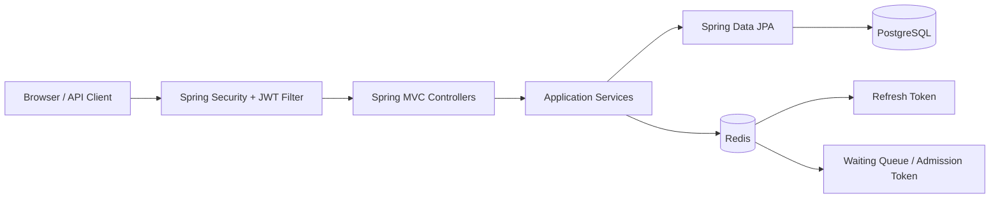
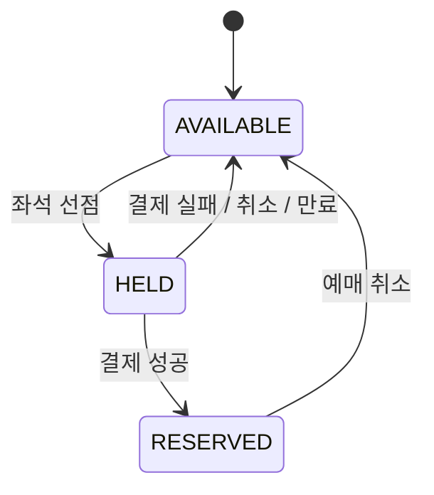
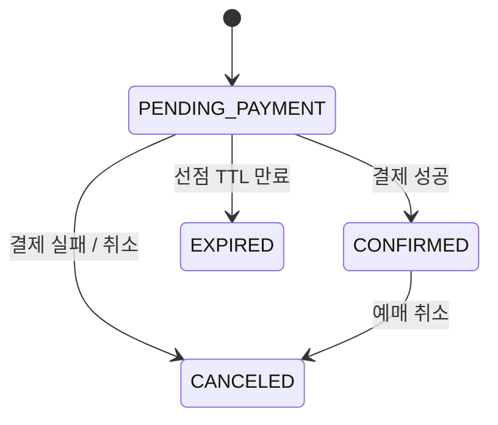

# CONCERTIX

동시 예매 상황에서 좌석 중복 선점을 방지하고, 결제·만료·대기열까지 상태 정합성을 유지하는 콘서트 티켓팅 백엔드 프로젝트입니다.

## 핵심 포인트

- 동일 좌석에 대한 비관적 락(`PESSIMISTIC_WRITE`) 기반 선점 제어
- JWT Access Token + Redis Refresh Token 인증 구조
- 공연/회차/좌석/예매/가상 결제 전체 상태 전이
- 만료된 좌석 선점의 재선점 및 과거 예약 취소 정합성 보장
- Redis Sorted Set 기반 공연별 대기열 및 TTL 입장 토큰
- PostgreSQL + Flyway 스키마 마이그레이션
- Testcontainers 기반 PostgreSQL/Redis 통합 테스트
- k6 동일 좌석 50/100 동시 요청 경합 테스트

## 기술 스택

- Java 21
- Spring Boot 4.1.1
- Spring MVC / Spring Security / Spring Data JPA
- PostgreSQL 17
- Redis 7
- Flyway
- JJWT
- Testcontainers
- Gradle
- Docker Compose
- k6

## 아키텍처



## 주요 상태 전이





## 동시성 전략

예매 요청은 좌석을 조회할 때 DB 비관적 쓰기 락을 획득합니다.

1. `SeatRepository.findByIdForUpdate()`로 대상 좌석 잠금
2. 공연 공개 상태, 예매 기간, 구매 한도 검증
3. 좌석 상태 및 기존 활성 선점 검증
4. `AVAILABLE -> HELD` 전이와 Reservation 생성을 하나의 트랜잭션에서 처리

같은 좌석에 요청이 동시에 몰려도 먼저 락을 획득한 한 요청만 성공하고 이후 요청은 상태 재검증에서 충돌 처리됩니다.

## 대기열

대기열은 공연별로 활성화할 수 있습니다.

- Redis ZSET: 대기 순서
- 입장 인원 제한: `app.queue.max-admitted`
- 입장 토큰 TTL: `app.queue.admission-ttl`
- 활성 공연 예매 시 `X-Queue-Token` 검증
- 만료되거나 다른 사용자의 토큰으로 대기열 우회 불가

자세한 계약은 `QUEUE-001.md`를 참고합니다.

## k6 결과

`perf/k6/reservation-race.js`로 하나의 좌석에 병렬 요청을 보냈습니다.

| 동시 요청 | 201 성공 | 409 충돌 | 예상 외 응답 | p95 |
|---:|---:|---:|---:|---:|
| 50 | 1 | 49 | 0 | 약 287 ms |
| 100 | 1 | 99 | 0 | 약 909 ms (최종 코드 재실행) |

100개 경합에서도 중복 선점 없이 정확히 한 요청만 성공했습니다. 이 테스트는 단일 개발 PC 기준 결과이며 운영 환경의 절대 성능 수치로 해석하지 않습니다.

## 테스트

현재 전체 자동화 테스트 결과:

- 22 tests
- failures 0
- errors 0
- skipped 0

```powershell
.\gradlew.bat --no-daemon test
```

k6:

```powershell
k6 run .\perf\k6\reservation-race.js

$env:CONCURRENCY=100
k6 run .\perf\k6\reservation-race.js
```

## 로컬 실행

```powershell
docker compose up -d
.\gradlew.bat bootRun
```

기본 주소: `http://localhost:8081`

개발용 테스트 계정:

- 관리자: `admin@concert.com` / `admin1234`
- 사용자: `user1@concert.com` / `user1234`
- 사용자: `user2@concert.com` / `user1234`

## 주요 API

- 인증: `/api/auth/**`
- 공연: `/api/concerts/**`, `/api/admin/concerts/**`
- 좌석: `/api/concerts/{concertId}/sessions/{sessionId}/seats`
- 예매: `/api/reservations/**`
- 결제: `/api/payments/**`
- 대기열: `/api/queues/**`, `/api/admin/queues/**`

## 다음 개선 항목

- 서로 다른 좌석에 대한 처리량 부하 테스트
- 대기열 적용 전/후 서버 부하 비교
- Redis Lua Script 또는 원자적 admission 처리 강화
- CI 파이프라인 및 배포 환경 구성
- 운영 프로필에서 JWT 기본 secret 제거
- 관리자 대시보드 및 성능 지표 시각화
